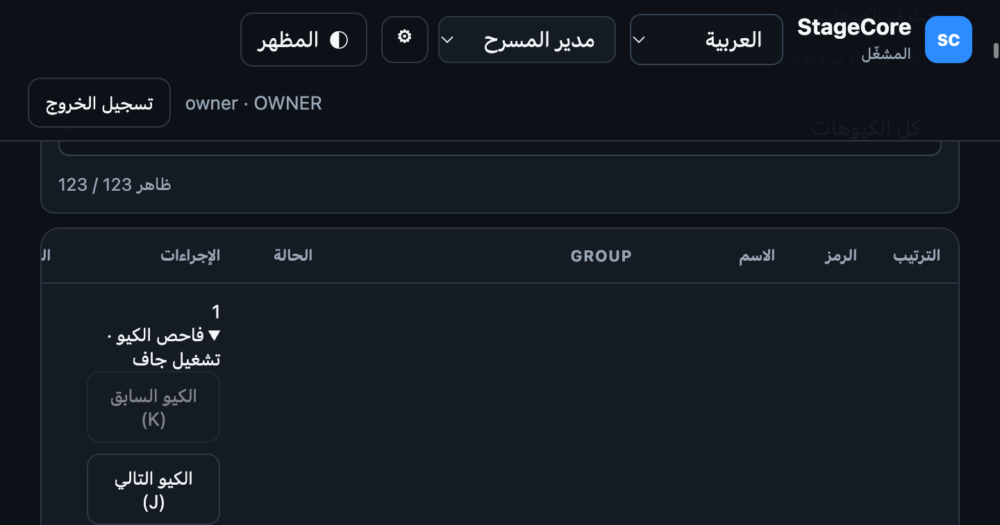
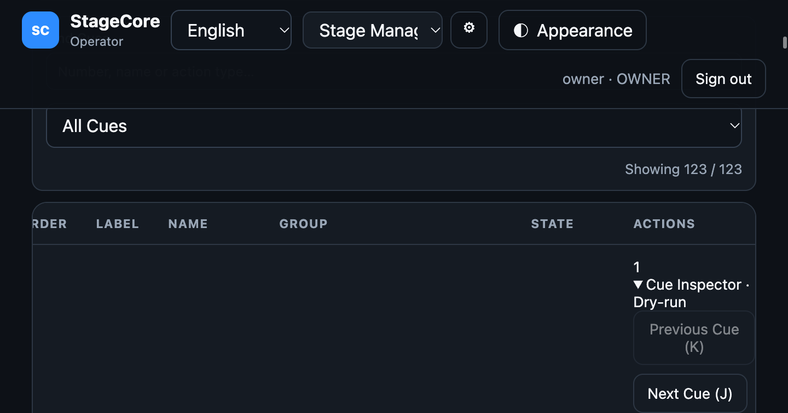

# SC-018 Cue Inspector at 200% browser zoom

Captured by the real-Chrome `TestBrowserCreatesNestedMixedCueChainInDraft`
gate using an isolated temporary SQLite project with 123 Draft Cues. Chrome
opened a 1440px-wide window with its browser page zoom set to 200%; the page
reported a 720px CSS viewport and `devicePixelRatio=2` in both locale runs.

The test verified that the document has no horizontal overflow and the Cue
Inspector navigation stays within the viewport in Arabic RTL and English LTR.
At this zoom the Cue table remains internally scrollable: 660/720px
client/scroll width in RTL and 660/794px in LTR. The test made no Project API
mutations, started no Runtime Session, and sent no output command.

These screenshots qualify only the Cue list/Inspector route. The remaining
Operator routes still need their own screenshot and zoom review; tablet
hardware fit remains separate.
